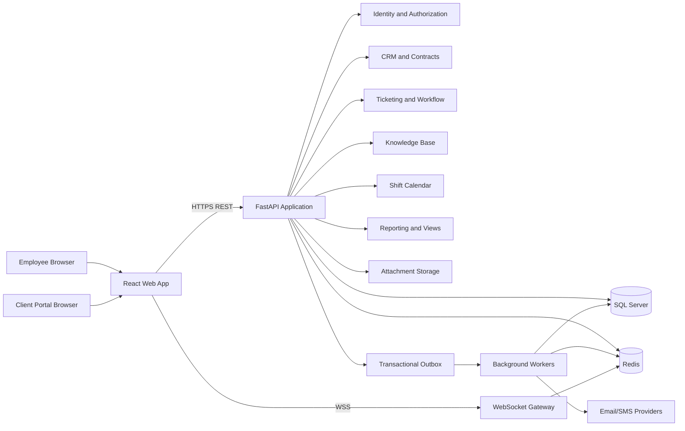

# Technical Architecture

## 1. Architecture Principles

- Modular monolith first
- API-first design
- Deny-by-default authorization
- Clear domain boundaries
- SQL Server as system of record
- Background jobs for slow or retryable work
- Idempotent event handling
- UTC storage and timezone-aware display
- Auditability before automation
- Configuration instead of hard-coded client rules
- Observability built into every module

## 2. Logical Architecture



## 3. Backend Domain Modules

```text
app/
  api/
  core/
  identity/
  organizations/
  crm/
  contracts/
  service_catalog/
  tickets/
  workflow/
  sla/
  assignment/
  escalations/
  notifications/
  knowledge/
  workforce/
  imports/
  reporting/
  attachments/
  integrations/
  audit/
```

Each module should contain, as appropriate:

- `models.py`
- `schemas.py`
- `repository.py`
- `service.py`
- `policies.py`
- `routes.py`
- `events.py`
- `tasks.py`
- `tests/`

Do not let route handlers contain business rules. Routes validate transport concerns, call services, and map results.

## 4. Frontend Architecture

```text
src/
  app/
  auth/
  components/
  features/
    clients/
    contracts/
    tickets/
    knowledge/
    workforce/
    dashboards/
    administration/
  hooks/
  layouts/
  lib/
  routes/
  services/
  types/
```

Use feature folders. Shared components must be generic; domain-specific logic stays inside the feature.

## 5. API Design

- Prefix: `/api/v1`
- JSON request/response
- OpenAPI documentation
- Cursor pagination for large activity feeds; page pagination for administration lists where appropriate
- Stable error envelope
- Correlation ID on every response
- Optimistic concurrency token for mutable records
- Idempotency key for creation endpoints exposed to integrations

Example error envelope:

```json
{
  "error": {
    "code": "TICKET_TRANSITION_NOT_ALLOWED",
    "message": "The ticket cannot move from Closed to In Progress.",
    "details": {},
    "correlation_id": "..."
  }
}
```

## 6. Persistence Patterns

- Repository/query layer for complex database access
- Unit of work/transaction boundary at application-service level
- Foreign keys enabled for all relationships
- `rowversion` columns for optimistic concurrency
- Soft delete only where recovery/business history requires it
- Immutable audit events for sensitive actions
- Temporal tables for selected records such as contract terms and critical configuration
- Transactional outbox for notifications and integrations

## 7. SQL Server Connectivity

Recommended URL pattern uses ODBC Driver 18 and encryption. Never commit the actual connection string.

Important practices:

- Use parameterized queries only.
- Use application-managed connection pooling.
- Set command timeouts explicitly.
- Keep transactions short.
- Use `READ_COMMITTED_SNAPSHOT` after DBA review to reduce read/write blocking.
- Index foreign keys and common filter/sort columns.
- Capture slow-query telemetry.
- Avoid dynamic SQL for user filters; compile a safe filter AST into parameterized predicates.

## 8. Background Processing

Use durable workers for:

- Email and SMS delivery
- SLA recalculation
- Escalation evaluation
- Contract renewal reminders
- Search indexing
- Excel import processing
- Report generation
- Attachment malware scan orchestration
- Integration retries

Every job needs:

- Unique job/event ID
- Idempotency behavior
- Retry policy with exponential backoff
- Maximum attempts
- Dead-letter state
- Correlation ID
- Structured logs and metrics

## 9. Real-Time Design

WebSockets deliver:

- Ticket assigned
- Ticket updated
- New public reply
- Mention
- SLA warning or breach
- Escalation
- Critical incident
- Import completion

Source of truth remains SQL Server. Redis is used for fan-out, not permanent business storage. When a user reconnects, fetch missed notifications using the last acknowledged notification sequence.

## 10. Attachment Design

Preferred storage options:

- Internal S3-compatible object storage, Azure Blob, or protected file storage
- SQL Server stores metadata and object key, not large file bytes

Controls:

- Random object key
- Original filename sanitized
- Content type determined server-side
- Extension and MIME allowlist
- Size limits
- Malware scanning status
- Authorization on every download
- Short-lived signed URL or application streaming
- Hash for duplicate detection and integrity
- Retention and legal hold support

## 11. Deployment Topology

### Small Production

- Two web application nodes behind reverse proxy/load balancer
- One or more worker processes
- Separate SQL Server
- Redis with persistence/availability appropriate to criticality
- Shared/object attachment storage
- Central log/metric collector

### Environments

- Local
- Development
- Test
- UAT
- Production

Never use production data in lower environments unless sanitized and approved.

## 12. Availability and Recovery

Define and approve:

- RTO
- RPO
- Database backup frequency
- Transaction log backup frequency
- Attachment storage backup
- Encryption key backup
- Restore testing schedule
- Application rollback procedure

The application must expose:

- `/health/live`
- `/health/ready`
- `/health/dependencies`
- `/version`

## 13. Architecture Decisions to Record

Create ADRs for:

1. FastAPI modular monolith
2. React UI framework
3. SQL Server and supported version
4. Redis/background queue
5. Authentication model
6. Attachment storage
7. SLA time-calculation strategy
8. Search implementation
9. Multi-client data isolation
10. Deployment platform
